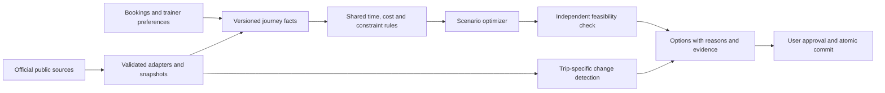

# Atlas travel intelligence: product and engineering plan

Status: proposed implementation plan, 2026-11-05. This document does not activate integrations, alter the saved environment configuration, publish the environment, or push repository changes.

For the November 6 code ownership audit and additional aviation-source connections, use the [aviation integration blueprint](../../../docs/architecture/AVIATION_DATA_CONNECTIONS.md). It distinguishes the implemented foundation from the proposed expansion and maps source permissions, evidence, API contracts and app consumers.

## The product promise

Help two field trainers choose a workable journey, understand its tradeoffs, and respond to changes with the best evidence available.

The main experience should answer four questions:

1. What is the most useful field trip for each of us?
2. How do we get from home to the appointments and back with sensible margins?
3. What evidence supports this plan, and what still needs verification?
4. What should we review when an input changes?

Product principles: one clear next action; consistent language and controls; fast interaction; visible save/recovery states; evidence available without overwhelming the main screen. Keep Atlas, Travel, People and Calendar stable, with Intelligence as a fifth visible primary destination. Its six illustrated tools are available directly on the Travel landing page and through workspace search.

## Starting point and important gaps

The local first release already supplies setup, separate demo data, a guided trip planner, smaller artwork, deferred street-map loading, and coordinates for the U.S. starter airport reference. The existing app contains itinerary parsing, public weather/airport adapters, historical summaries, trainer coordination rules, conditional record updates, and atomic trip-plus-visit writes.

The next implementation must address these specific gaps:

- `TravelLogic.ts` estimates roads from straight-line distance, a multiplier, and an assumed speed. This does not establish a feasible driving route or current traffic.
- `CoordinationLogic.ts` selects days using regional proximity and fixed heuristic weights. It is not a complete two-trainer journey optimizer.
- Booking and meeting times are predominantly date/time strings. They need explicit airport and location time zones before cross-zone feasibility can be asserted.
- `flightHistory.ts` reads independent BTS aggregates. The source contains publication thresholds and coverage limits; it is not a complete direct BTS ingestion pipeline.
- Freshness/coverage handling differs between providers, and several caches are process-local.
- Trip/visit writes are atomic, but availability/overlap reads happen before the write transaction. Concurrent approvals need a commit-time consistency mechanism.
- Imported booking details are currently stored on the device. Any server analysis or partner sharing must be an explicit, limited transfer rather than an assumed new source of shared records.
- The environment currently restricts outbound destinations. A coded adapter or passing fixture test does not establish a working live connection.

## 1. The travel experience

### Plan together

Use each trainer's home airports, working hours, unavailable dates, manager relationships, visit duration, travel preferences and overnight limits. Classify each preference as required, preferred, or unknown.

Keep manager handoffs explicit. An optimizer may suggest a different trainer; it must not silently change ownership.

### Compare a small set of useful options

Show up to three distinct, feasible candidates rather than one unexplained score:

- Balanced field plan: coaching coverage, travel burden and estimated spend.
- More time at home: fewer nights away and less travel, subject to required visits.
- Lower estimated spend: compare known costs using the same assumptions and coverage.

Each option shows managers covered, appointment windows, nights away, known/imported flight legs, estimated road travel, cost components, constraints, and evidence gaps. An unknown fare is not zero. A historical route is not an available flight. Do not rank two prices as comparable if one omits major components.

For scenarios without actual flight candidates, rank arrival gateways and field circuits as provisional. Confirm air feasibility after importing or entering real itinerary options.

### Review and approve

One review screen shows the selected plan, important assumptions, unresolved constraints, source freshness and changes since the preview. Approval revalidates the current workspace and commits the itinerary and visits together with an idempotency key.

Keep plan approval separate from booking evidence. Suggested labels:

- Plan: Draft / Reviewed / Approved / Needs review.
- Flight evidence: Imported itinerary / User-entered option / Checked with airline at a stated time / Not checked.

Importing a confirmation does not mean subsequent airline changes have been checked.

### Travel day

Provide a short brief: next appointment, journey sequence, time-zone labels, applicable notices, useful contact/directions links, and the next action. Display a leave-by estimate only when the required itinerary, location, road duration and buffer inputs exist; disclose the assumptions.

When new evidence affects a trip, explain the change and offer alternatives. Do not silently move meetings or cancel plans.

## 2. Source integration decisions

| Need | Primary source / technology | What it supports | Limits and fallback |
| --- | --- | --- | --- |
| Airport reference | OurAirports downloads | Coordinates, IATA/ICAO mapping, airport infrastructure and alternate gateways | Not airline schedules. Keep a versioned last-valid snapshot and clearly label limited starter coverage. |
| Airport-wide operational notices | FAA NAS status | Ground stops, delay programs and relevant airport restrictions | Not flight-specific status. Validate endpoint schema, usage conditions, notice timing and airport coverage before enabling. Missing/omitted evidence remains unknown. |
| Aviation conditions | NOAA Aviation Weather Data API | Published METAR/TAF and supported aviation advisories | Match ICAO, observation time and forecast validity to the relevant leg. An airport weather signal does not establish a cancellation. |
| U.S. destination weather | NWS API | Forecast periods and alerts near airports and appointments | Use only published coverage/validity. Far-future trips get historical context or unavailable forecasts, not invented forecasts. |
| Canadian weather | ECCC MSC GeoMet / OGC services | Appropriate Canadian observations, forecast and warning products | Select and verify specific collections/products, units and update schedules in the access-validation phase. Do not assume U.S. NWS coverage. |
| Historical flight performance | Direct U.S. DOT/BTS reporting-flight records | Observed delay distributions, cancellations and diversions by supported route/carrier/time cohort | Publication lag, reporting scope and sparse samples are visible. Canada/international coverage will differ. No automatic claim that an old service operates today. |
| Road travel | OpenStreetMap + OSRM, or a validated capped hosted routing service | Drivable route and duration/distance matrices | Static/profile-based road estimates are not live traffic. Public demonstration servers are not a production dependency. Self-hosting requires compute and map updates. |
| Two-trainer optimization | Google OR-Tools | Assignment, ordering, visit windows, working hours, breaks and constraints | No flight inventory. Only supplied, evidenced flight candidates may be treated as flight options. Solver output must pass independent feasibility validation. |
| Time zones | IANA zones plus a maintained time library | Correct duration, local-time display, overnight travel and daylight-saving behavior | Resolve airport and appointment zones explicitly. Ask for clarification on ambiguous or nonexistent local times. |
| Budget benchmarks | User/company rates; optionally GSA reference data | Transparent lodging/meal planning allowances | Not hotel availability or prices. Verify API access/key terms before use. |

Primary implementation choice: OR-Tools for the two-trainer planner, with one road-routing adapter. VROOM is a credible alternative for a narrower visit-routing service; do not deploy two solvers initially.

Aircraft-position feeds, scraped security-queue estimates and third-party travel summaries are optional context. Core feasibility must continue to work without them. Preserve the distinction between sampled historical checkpoint estimates and current measured wait times.

Comprehensive live fares, seat availability, current schedules, gates, flight-specific status and authoritative connection requirements are outside the dependable free-data foundation. Use imported/user-verified options and airline links initially. Evaluate a commercial connector later only if its coverage, terms and cost justify it.

## 3. The evidence contract

Every external fact should carry:

- Provider and source URL; source record/product identifier when present.
- Subject: airport, route, location or flight leg.
- Observation/issue time, retrieval time, valid period, and data version.
- Units, geographic coverage, historical sample count/period where relevant.
- Evidence kind: observation, forecast, historical statistic, reference, traveler-provided, or estimate.
- Availability and freshness state, with a human-readable limitation.
- Attribution/license metadata and the adapter version that interpreted the source.

Use source/product validity rather than a single global freshness timer. Recently downloaded old observations are still old. A valid historical report can remain useful while a current operational feed is unavailable.

UI examples:

- "From your imported booking; airline changes not checked."
- "Airport notice retrieved recently; applies during the departure window."
- "Road-network estimate; traffic not included."
- "Historical route sample: reporting period and operation count shown."
- "Current weather check incomplete; provider unavailable."

Display evidence coverage separately from recommendation priority. Do not label a trip safe, guaranteed, or low risk because a feed failed or returned no matching record. Do not present an uncalibrated score as a probability of making a flight or meeting.

## 4. Shared journey and decision model

Introduce typed entities for trainer IDs, manager IDs, locations/time zones, journey legs, appointment windows, overnight stops, preferences, source snapshots, scenario options and approvals.

Use stable trainer IDs for relationships; names are display values. Preserve date-only availability as local date ranges. Store actual scheduling instants with UTC representations, IANA zones and the original entered local values so changes remain explainable.

Build journeys as connected legs: home access → airport processing → flight(s) → arrival processing → ground transport → appointments/overnight stop → return journey. Every leg has duration provenance, assumptions and availability, rather than one opaque total.

Hard constraints include blocked dates, overlapping appointments, supplied flight timings, confirmed meeting windows, required breaks and maximum work/travel limits. Soft preferences include preferred airports, fewer transfers, less time away, manager continuity and spending goals. Expose editable default assumptions; do not hide a universal connection buffer inside the score.

For connections, distinguish domestic/international procedures, terminal/airline changes, separate tickets, checked bags and other traveler-supplied requirements. Authoritative minimum connection times may require licensed data; contextual planning buffers are labeled separately.

Costs are component-based: entered fare, supplied baggage/fees, parking/access, rental, lodging, meals and optional value-of-time assumptions. Report missing components and ranges instead of filling unknowns with zero.

Optimize assignments and visit order against road-time matrices and known journey windows. Return useful alternatives, including a clear explanation when required visits cannot fit. Independently validate every solver result; do not assume the solver found the global optimum or that an unconstrained air leg is feasible.

## 5. Backend architecture

Suggested boundaries:

- `backend/providers/`: FAA, aviation weather, NWS, ECCC, airport reference, BTS and road routing adapters.
- `shared/travel/`: types, time-zone handling, cost components, constraints, evidence labels and scenario validation.
- `backend/travel/`: facts/scenario services, approval/commit, repositories and change assessment.
- `backend/jobs/`: durable ingestion and monitoring jobs.
- `services/optimizer/`: a small, version-pinned OR-Tools worker, with bounded runtime and a typed input/output contract.
- `src/travel/`: focused planning, comparison, trip and review screens using existing app primitives.

Extend existing APIs instead of creating a parallel planner: scenario preview reads a versioned facts snapshot; the existing travel commit operation is strengthened with commit-time conflict validation and a persisted revision/consistency mechanism. Replaying an approval must not create duplicates. Two concurrent incompatible approvals must not both succeed.

Keep remote fetching and optimization outside short database write transactions. For the current two-trainer single-instance app, SQLite can remain the durable store. Add explicit migrations, typed/indexed scheduling records and job state. Multiple app instances would require a deliberate shared-database/event-delivery design.

Persist source/job state so restarts do not erase freshness evidence or scheduled work. Use bounded retries, backoff, timeouts, response-size/schema validation, request deduplication and retention limits. Quarantine a changed/malformed payload rather than replacing the last valid snapshot.

Booking ingestion continues to extract only the fields needed for planning. Preserve device-only use by default; make server analysis or partner sharing explicit and limited to chosen itinerary fields. Do not store raw confirmations, booking references, passport data or payment information merely to improve route planning.

## 6. Collection and monitoring policy

- Airport reference: start with a daily change check, retaining the last valid version.
- BTS: ingest each newly published reporting period once; compute small queryable aggregates in background jobs, never in the phone browser.
- Routing: cache matrices by location pair, routing profile and map/engine version. Start with the actual regions traveled rather than an unbounded global routing deployment.
- Forecasts/notices: fetch on relevant trip views and with bounded monitoring for upcoming journeys. Refresh according to product validity, source update frequency and permitted service usage, not a universal timer.
- Change detection: compare new relevant evidence with the approved plan and emit one deduplicated review item when it changes a decision.
- Begin with in-app briefs/review items. Background push or email is a separate opt-in feature with delivery and permission testing.

For trips beyond the available forecast horizon, show historical/seasonal context and schedule a later forecast check. Current notices for an unrelated date must not be applied to a future trip.

## 7. Delivery sequence and release gates

| Phase | Deliverable | Required proof before release |
| --- | --- | --- |
| 0 — Access and coverage | Provider registry, verified endpoints/products, documented licenses/attribution, rate/access requirements, narrow network additions for review, sample payloads | A real allowed request to every enabled source validates expected fields, timestamps and coverage. Blocked sources remain explicitly disabled/unavailable. |
| 1 — Reliable journey foundation | Stable IDs, explicit zones, shared constraints, versioned evidence, hardened approval consistency | Daylight-saving/overnight/cross-zone cases pass; conflicting concurrent approvals are rejected; replay creates no duplicates; current first-release tests remain green. |
| 2 — Door-to-door planning | Road matrices, full journey legs, component costs and paired-trainer scenario generation | Representative circuits are compared with independently checked routes and supplied flight options; unknown legs/costs remain visible; infeasible cases are explained. |
| 3 — Historical flight knowledge | Direct BTS ingestion and transparent aggregates | Results reconcile against official source samples; carrier/route/cohort labels and sample counts are correct; unsupported legs do not inherit misleading airport-wide probabilities. |
| 4 — Trip watch and recovery | Durable relevant-source refresh, travel brief and reviewed alternatives | Expired forecasts, missing airports, provider outages and changed bookings produce appropriate review states without silently editing approved plans. |
| 5 — Pilot and polish | Desktop/mobile comparison and travel-day workflows refined with both trainers | Both trainers complete representative tasks; real-trip feedback exposes estimate errors; accessibility, performance and recovery gates pass before broad reliance claims. |

Phases 2 and 3 can share preparation work after the evidence/time foundation exists. A monitored travel-day feature can ship only for sources whose access and coverage have passed Phase 0; other providers stay visibly unavailable.

## 8. Pilot and acceptance criteria

Pilot representative cases rather than only happy paths: nonstop domestic, connecting domestic, U.S.–Canada, different trainer origins, cross-zone appointments, overnight flights, tight working days, a day with no workable itinerary, unavailable road links, sparse history and an upstream outage.

Required checks:

1. Every displayed option passes all known hard constraints or is clearly provisional with the specific unresolved input.
2. Date/time tests cover spring gaps, repeated autumn times, overnight/date changes and local all-day availability.
3. Flight marketing/operating-carrier distinctions and historical route mismatches are handled explicitly.
4. Missing/expired weather, routing or operational evidence never produces a reassuring current-data claim.
5. Concurrent approval, retry, restart and restore tests protect existing records and prevent duplicate visits.
6. Historical aggregates reconcile to source records and expose reporting period, sample size and unmatched coverage.
7. Both trainers can compare options, inspect reasons, adjust a constraint and approve the selected trip without losing their draft or place.
8. Phone checks include text scaling, touch targets, keyboard/VoiceOver navigation, poor connectivity, draft recovery and readable local-time labels.
9. Set and measure a bounded scenario response budget on the chosen deployment host; keep heavy imports/background processing off interactive requests.
10. Record actual planning usefulness and estimate error during the pilot before promoting rankings to predictive claims. Collect this through explicit feedback rather than requiring continuous location tracking.

Performance targets to verify, not current measurements: p75 LCP at or below 2.5 seconds, INP at or below 200 ms, and CLS at or below 0.1 on defined representative devices/connections; report scenario execution time and failure rate separately.

## 9. Free-data and operational boundary

The foundation assumes no paid flight-data subscription. Open-source software and public data do not make hosting, map processing, storage or maintenance costless. Prefer cached, low-volume source access appropriate for two trainers. Before choosing any hosted free tier, verify current business-use terms, attribution, quotas and permitted caching. Do not treat a trial or public demo endpoint as an unlimited production entitlement.

Direct access to several official service sites is restricted in the current environment; publication of the cloud environment did not establish connectivity to those providers. Any runtime changes require supported environment settings review. This planning task does not change the allowlist or publish configuration.

Inputs to capture during implementation: both home/departure airport sets, typical travel regions, working windows, overnight preferences, required appointment windows, minimum visit durations, and whether the two trainers want to share sanitized booking legs. Preferences can be gathered progressively; missing information stays visible.

## Reference documentation

- FAA NAS: https://nasstatus.faa.gov/
- NOAA Aviation Weather API: https://aviationweather.gov/data/api/
- NWS API: https://www.weather.gov/documentation/services-web-api
- ECCC MSC GeoMet: https://eccc-msc.github.io/open-data/msc-geomet/readme_en/
- ECCC source documentation verified for this plan: https://github.com/ECCC-MSC/open-data/blob/master/docs/msc-geomet/readme_en.md
- BTS reporting-flight records: https://www.transtats.bts.gov/ONTIME/
- OurAirports: https://ourairports.com/data/ and https://github.com/davidmegginson/ourairports-data
- OpenStreetMap licensing: https://www.openstreetmap.org/copyright
- OSRM: https://github.com/Project-OSRM/osrm-backend
- Google OR-Tools: https://developers.google.com/optimization and https://github.com/google/or-tools
- VROOM alternative: https://github.com/VROOM-Project/vroom
- IANA time-zone database: https://www.iana.org/time-zones
- GSA per diem reference: https://www.gsa.gov/travel/plan-book/per-diem-rates

Open-source project documentation and ECCC's published documentation were accessible through their official GitHub repositories. That verification is distinct from live API connectivity, current quotas/commercial permissions, specific Canadian collection validation, and production readiness; those remain Phase 0 work.
