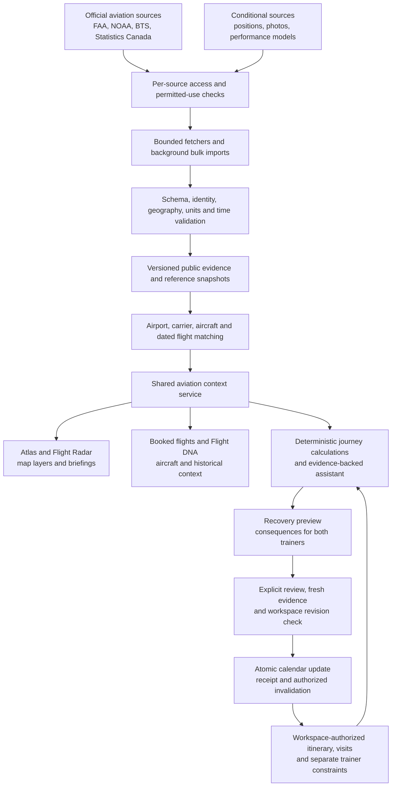
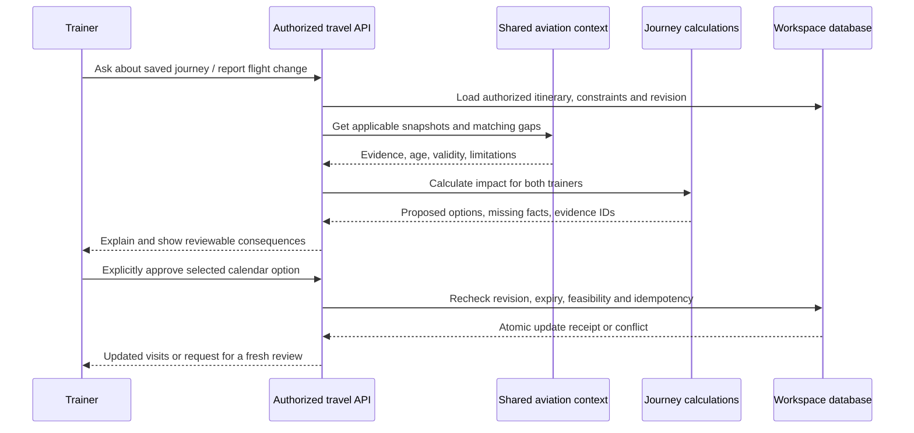

# Aviation data connections across Field Sales Atlas

For the current provider → API → screen inventory and remaining gaps, see
[Active travel data map](ACTIVE_TRAVEL_DATA_MAP.md). This older expansion
blueprint retains its proposed status where the active inventory says otherwise.

Status: **implementation blueprint, not activated integrations**. Reviewed November 6, 2026 against repository revision `070b644`. This change adds the connection map and source research; it does not install feeds, import production data, enable commercial services, change appointments or publish the app.

Read the [aviation research](../research/AVIATION_DATA_AND_AI_RESEARCH_2026-11-06.md) and [28-source catalog](../research/aviation-source-catalog.csv) for source evidence and restrictions. The [machine-readable connection map](aviation-connections.json) records existing owners, proposed routes, source-to-screen connections, dependencies and activation blockers. It is a planning artifact, not runtime configuration. Earlier [travel implementation notes](../../artifacts/field-sales-atlas/docs/TRAVEL_INTELLIGENCE_IMPLEMENTATION.md) describe the existing foundation; this document specifies its aviation expansion.

The subsequent [journey-readiness implementation](JOURNEY_READINESS.md) ships the shared calculation, review states, resource checks and update guards. Its actual routes are documented there; the wider source integrations below retain their proposed status.

## 1. End-to-end connection map

Public adapters never receive manager names, booking references, trainer identity, calendar text or full private itineraries. The context service joins public facts to private journeys inside the authorized workspace. Public facts may be cached across workspaces; private matches, calculations and reports may not.

Position observations, airport notices, forecasts, historical records and traveler-reported itinerary fields remain different kinds of evidence throughout this graph. A map overlay cannot mutate a flight record or calendar.

## 2. Current owners and gaps found in the code

Repository paths in this document are relative to the repository root. The running API uses `artifacts/api-server/src/field-atlas/`; do not implement new integrations only in the preserved standalone backend under the UI artifact.

| Existing owner | Current connection | Work needed for the expansion |
| --- | --- | --- |
| `backend/providers/airports.ts` | OurAirports and limited starter fallback; IATA-to-ICAO/location lookup | Preserve source identity, effective versions and fallback coverage. Add website/runway links and separate airport-reference entities; do not infer all global aerodromes from an importer that currently selects scheduled-service airports with IATA codes. |
| `backend/providers/publicTravel.ts` | FAA NAS, METAR/TAF, NWS and Canadian surface evidence | Share normalized results with every travel screen. Correct the ECCC schema/recency issue before Canadian weather is described as ready. Add new hazards as separate typed adapters. |
| `backend/providers/evidence.ts` | Bounded JSON fetch, request deduplication, persistent evidence cache and stale fallback | Preserve failure reasons, add immutable snapshot identity and structured provenance. Add separate bounded text and bulk-file ingestion paths: the current JSON parser/2 MB limit is unsuitable for FAA advisory HTML and aircraft archives. |
| `backend/index.ts` | Legacy disruptions, aviation, point-forecast, security/history routes | Adapt these existing response shapes to the common normalized services so legacy screens and the planner do not disagree. Keep route compatibility during migration. |
| `backend/providers/bts.ts` and `backend/flightHistory.ts` | Direct imported BTS history and separate derived history | Retain source/cohort boundaries, distinguish imported from third-party aggregates, and add T-100/OD40 using dedicated schemas. |
| `backend/providers/connections.ts` | Reference/history/routing status and sampled provider validation | Add readiness per source/product, not one global connected flag. Configuration, permissions, successful sample and healthy production data are separate states. |
| `backend/travel/scenarios.ts`, `assistant.ts`, `recovery.ts`, `context.ts` | Saved constraints, two-trainer calculations, claims and reviewed changes | Consume the same aviation context; carry immutable evidence references into answers and previews. Extend alternative-airport recovery deliberately: current recovery rejects different airport pairs. |
| `backend/travel/watch.ts` | Periodic checks for saved journey arrival airports | Extend to unique airports in the actual itinerary and relevant travel windows. Retain leases, deduplication, cancellation and bounded retries. Do not interpret a notice change as a confirmed flight change. |
| `src/FlightGuardian.tsx` and `src/BookedFlightLogic.ts` | Booking imports saved in localStorage | Keep local drafts local. Review selected legs before using the existing journey attachment endpoint; a laptop import is not automatically shared with the partner or phone. |
| `shared/travel/types.ts` and UI `shared/travel/types.ts` | Two copies of the travel contract | Add backwards-compatible fields in both until a shared package replaces duplication. Add a parity check before relying on new fields across API and UI. |

The UI calls `/api/flights/status` and `/api/flights/search`, but the active backend explicitly disables commercial offer search (`connected: false`, search returns 410). Preserve the free-data-only behavior. This blueprint does not reconnect Duffel, buy a subscription or turn public tracking into flight inventory.

## 3. Source-to-feature connections

All new integrations below are proposed. Readiness must be established in the actual Replit runtime before activation.

| Source / data product | Proposed ingestion and normalized output | Consumers | Accuracy and activation conditions |
| --- | --- | --- | --- |
| FAA registration master plus aircraft reference | Background download, validate archive/schema, join master to make/model reference; `AircraftProfile` | Aircraft detail in Booked flights, Flight Radar, assistant reference answers | Daily published refresh; U.S. registrations only. No owner personal fields. Tail number/hex matching is dated; registered owner is not airline operator. |
| FAA Aircraft Characteristics XLSX | Background edition import; `AircraftTypeProfile` keyed by exact ICAO type/variant | Aircraft card, map categories, aircraft explanation | Actual workbook fields verified; label the October 2024 reference edition. Engine count/dimensions do not establish cabin, seats or Wi-Fi. |
| FAA ATCSCC operations plans | Bounded text/HTML parser; `OperationalNotice` with advisory ID and active/planned/possible/cancelled state | Flight Radar, airport brief, assistant and monitoring | Preserve original text, issue/event times and replacement chain. Parse UTC and cross-midnight validity. Possible ground stop is not active. Airport constraint is not flight-specific causation. |
| NOAA SIGMET/G-AIRMET/CWA/PIREP | Server JSON/GeoJSON adapters; `HazardFeature` and `PilotReport` | Atlas map, Flight Radar and journey brief | Product-specific geography, altitude and validity. Validate geometry and each feature's dates; empty response and provider outage differ. An approximate airport corridor is not the flight's confirmed path. |
| FAA NASR and diagrams | Cycle-based airport/runway import and curated official links | Airport reference panel, map infrastructure layer and assistant | Effective edition and reference scope visible. An old download is not made current by a recent fetch. No claim to real-time gate/terminal amenities. |
| Statistics Canada aviation tables | Background table-specific CSV import; monthly movement and annual passenger cohorts | Canadian airport profile, Flight DNA and historical context | Open Government Licence attribution. Preserve reporting periods, revised series and definitions; movements include operations beyond passenger service. |
| BTS T-100 Segment | Background passenger-service segment import; directional route/carrier/month metrics | Flight DNA and alternate-airport research | Historical nonstop service/frequency/capacity; market records are not segment records. No future schedule or available-seat conclusion. |
| BTS OD40 and DOT consumer reports | Separate versioned importers; historical fare and passenger-experience measures | Flight DNA, supplied-quote context and assistant | Preserve sampling/schema, publication lag, reporting carriers and denominators. Historical fares and baggage/complaint rates are not current trip predictions. |
| adsb.lol positions | Bounded viewport/selected-aircraft proxy and short-lived cache; `AircraftObservation` | Optional Atlas aircraft layer and Flight Radar | Live production terms unresolved; historical ODbL does not itself establish live-service entitlement. Use `seen_pos` for position age, not only last message time. Never identify booked flight from callsign alone. |
| Planespotters or curated Commons images | Source-specific metadata adapter; `AircraftImage` with credit/link/license | Aircraft card | Planespotters JSON cache at most 24h, direct unchanged image URLs, no image rehosting or later storage. Its photos/metadata stay out of AI/ML datasets, training and evaluation. Commons requires per-file permission/credit. |
| OpenAP | Optional versioned server-side model; `ModeledAircraftComparison` | Educational aircraft reference and emissions comparison | LGPL/component data review and explicit mass/trajectory/load assumptions. Estimates are not measured flight fuel or per-passenger emissions. No safety score. |
| FAA NMS / SWIM | Access-request and service-specific integration after eligibility is known | Future operational notice enrichment | No production endpoint/rights assumed. SWIM may use Solace JMS and requires sustained ingestion, not just a request in the browser. |
| CATSA | Official current-wait link initially | Canadian airport brief and processing checklist | API/reuse entitlement not verified. Queue excludes screening processing, check-in/bags, preclearance and gate walk. No fabricated all-in airport wait. |

Sources with non-commercial or unresolved terms remain disabled: adsb.fi, OpenSky, airplanes.live, EUROCONTROL ADRR/performance/OPDI, unrestricted adsbdb route reuse and free Aviationstack business use. NTSB and UK CAA are optional reference/research work, subject to scope and terms; they are not required to make the core trainer journey work. The JSON map records all 28 catalog decisions.

## 4. Shared identities and evidence contract

### Identity rules

- **Airport:** internal stable reference ID, country, IATA/ICAO/local identifiers with provenance, coordinates, IANA zone and effective version. Weather-station identity is separate when it differs from the airport. Missing mapping returns unresolved; never manufacture a code by adding `K` or `C`.
- **Aircraft:** internal identity plus dated registration and hex aliases, manufacturer serial number where legitimately supplied, exact type code and source version. Preserve tail reuse, changed registration and missing/conflicting model data.
- **Carrier/flight:** distinguish marketing carrier, operating carrier and radio callsign; retain identifier system. Flight instance requires operating carrier/flight number, origin, service date/time zone and scheduled departure, with codeshare mapping only when sourced. Repeated flight numbers and overnight legs are not the same flight instance.
- **Traveler/trip:** workspace ID, stable trainer ID, shared journey ID and reviewed leg ID. Names are display values. A shared journey can contain different home airports, deadlines and permissions for the two trainers.
- **Match result:** `verified`, `traveler-supplied`, `candidate`, `ambiguous` or `unmatched`, with method and supporting snapshot IDs. These are proposed matching states, separate from existing evidence freshness states. Never promote a candidate tail/callsign match into a verified airline assignment.

### Extend, rather than replace, the current `Evidence`

Keep existing `kind`, `state`, `retrievedAt`, `observedAt`, validity, version, scope and limitation fields. The current states are `current`, `stale`, `unavailable`, `partial` and `reference`; do not introduce undocumented state strings into existing consumers.

Proposed additive provenance fields:

| Field | Purpose |
| --- | --- |
| `sourceKey`, `snapshotId`, `contentHash`, `adapterVersion` | Separate a logical request/cache key from an immutable observed payload and parser version. |
| `publishedAt`, `effectiveFrom`, `effectiveTo`, `reportingPeriod` | Separate publication, reference edition, historical period and operational validity. Unknown dates stay unknown. |
| `licenseId`, `licenseUrl`, `attribution`, `permittedUses` | Carry display/storage/derivation/model-training restrictions independently; no default permission inferred from access. |
| `coverage`, `units`, `sourceRecordId` | Define geography, product, units and publisher identity. |
| `cohort`, `sampleCount`, `denominator`, `revisionStatus` | Make historical statistics auditable and prevent incorrect comparisons. |
| `match`, `qualityFlags`, `failureCode` | Record how a fact applies and why it is incomplete, rejected or unavailable. |

A `snapshotId` identifies validated normalized content plus source identity, canonical query and adapter version; `retrievedAt` records each successful fetch separately. Preserve a receipt of which immutable snapshots an answer used. Existing saved reports embed `evidence[]`; they remain readable during migration.

Keep detailed failures such as timeout, access denied, rate limited, invalid schema, invalid timestamp, mismatched identity, no relevant record and no geographic coverage separate. The current cache's generic catch message should not erase the reason. HTTP 200 is not sufficient: reject HTML where JSON is required, malformed ZIP/XLSX, error objects and records with incompatible units or missing identity.

Reference/historical data is labeled with its edition/period; it is not labeled live. Missing runway/aircraft facts remain missing. Expired operational facts cannot support current claims. A fresh retrieval does not reset the observation's age. `204` or a validated empty product can mean no returned records; it does not prove an airport or flight is operating normally.

## 5. Proposed server connections and screen migration

The following routes are **proposed, not implemented by this documentation change**. Add them through `backend/travel/routes.ts` or a dedicated aviation route module composed there, retaining workspace authorization and query validation.

| Proposed route | Contract and implementation owner | Consumers |
| --- | --- | --- |
| `POST /api/travel/aviation/context` | Approved journey ID or bounded airport/time-window query; one assembled snapshot, evidence, gaps and matching state. Proposed `backend/travel/aviationContext.ts`. | All briefings, assistant and recovery. The server loads private journey records after authorization. |
| `GET /api/travel/aviation/aircraft/:registration` | Validated aircraft identity, reference facts, image metadata and evidence. Proposed `backend/providers/aircraft.ts`. | FlightGuardian, FlightRadar and an aircraft drawer. No flight-assignment conclusion implied. |
| `GET /api/travel/aviation/hazards` | Bounded geography, product and time filters; GeoJSON with evidence per feature. Proposed `backend/providers/aviationHazards.ts`. | LiveTerritoryMap and FlightRadar. Reject unsupported product/region/date combinations. |
| `GET /api/travel/aviation/positions` | Bounded viewport/selected-aircraft observations; live-only, age and coverage metadata. Proposed `backend/providers/aircraftPositions.ts`. | Optional map layer; disabled until rights/readiness pass. No arbitrary upstream URLs. |
| `GET /api/travel/aviation/airports/:code` | Reference, current valid notices and separately labeled historical cohorts. Proposed context/airport aggregation module. | Airport detail, Flight DNA and travel-day brief. |

Response shape: `data`, `evidence[]`, `snapshotIds[]`, `generatedAt`, `coverage`, `gaps[]` and optional per-item matching. An authenticated context response is private and must not enter a shared browser/service-worker cache. Public adapter caches contain public facts only. Do not expose restricted raw third-party data in an export route.

| Existing surface and files | Connection to use | Behavior that must match elsewhere |
| --- | --- | --- |
| Atlas: `src/MiamiMapHome.tsx`, `src/LiveTerritoryMap.tsx` | Common airport context, hazards and optional positions | Independent layer toggles; visible legend, source time, altitude/validity filters and unavailable state. Keyboard-accessible equivalent list. |
| Flight Radar: `src/FlightRadar.tsx`, `src/AirportDisruption.tsx`, `src/AviationWeather.tsx` | Same normalized context behind existing compatibility routes | Current operations versus selected future travel dates remain visibly distinct. No green “clear” state for omitted airports or failed feeds. |
| Booked flights: `src/FlightGuardian.tsx`, `src/BookedFlightLogic.ts` | Aircraft profile plus explicitly attached journey legs | Device import is local until reviewed/attached. Show trainer, service date, operator and verification state. Raw confirmation/PNR data is unnecessary for public-source lookup. |
| History: `src/FlightDnaPanel.tsx`, `src/SecurityHistory.tsx` | Common history/airport context with preserved source cohorts | Report period, sample size, carrier/direction and missing coverage; never combine incompatible denominators or treat an airport-wide measure as flight-specific. |
| Planner: `src/JourneyIntelligence.tsx`, `src/GuidedTripPlanner.tsx` | Shared context passed to `buildScenarios` | Supplied flight candidates plus road/processing allowances; historical routes remain research alternatives. Unknown fares are not zero. |
| Assistant/recovery/connections: `src/TravelIntelligenceDesk.tsx` | Existing travel routes enriched by the context service | Claims cite supporting evidence; both trainers and unresolved facts appear. Registry card facts do not answer a deadline question without an itinerary calculation. |
| Travel-day/mobile: `src/TravelStart.tsx`, `src/MobileJourneyPeek.tsx` | Same authorized shared journey and current context | Do not assume another device has the same local bookings. Offline view shows saved timestamp and stale/unknown state; revalidate on resume. |
| Calendar: `src/OperationsCalendar.tsx`, `src/TrainerCoordination.tsx` | Reviewed recovery approval only | No feed, map interaction or assistant answer writes appointments. Completed visits, ownership and unrelated plans remain protected. |
| Evidence UI: `src/TravelEvidence.tsx` | Shared evidence contract | Add period/edition, matching, attribution and failure explanations. Render per-source freshness; do not use the workspace “Live sync” indicator as a provider-health badge. |

During migration, the legacy `/api/travel/disruptions`, `/api/travel/aviation/:icao`, `/api/travel/weather-alerts`, `/api/travel/point-forecast` and `/api/travel/flight-history` responses keep their existing shapes through projection adapters. They should obtain data from the same normalized services rather than independently fetching/reinterpreting providers. Preserve the legacy aviation route's intentionally public, bounded station-only behavior if retained; never expose private journey context through it.

## 6. Refresh, storage and readiness

### Storage and imports

Use the existing `ATLAS_DATA_DIR` resolution and migration conventions. Proposed storage: versioned public reference datasets, compact normalized evidence snapshots, source import receipts and workspace-private context references. Names and schema are implementation decisions; adding this document does not create tables.

Bulk files are background jobs with size/decompression limits, checksums, schema checks, expected identity/row coverage, atomic activation and last-valid rollback. Keep raw data only where its terms permit; retain lawful validation receipts when full raw retention is prohibited. Aircraft registration and large history archives must not be fetched during a mobile request or startup. Avoid loading whole-country traces into the app database merely to answer a local map query.

SQLite needs durable storage, backups and a restore check. On one Replit instance, scheduled jobs can use database leases; scaled workers require shared lease/queue and storage semantics. A restarted/autoscaled process must not silently lose reference imports or run duplicate polling jobs. Git is not a database backup.

### Proposed application budgets, not provider guarantees

| Product | Initial application policy | Expiry and behavior |
| --- | --- | --- |
| Aircraft registry | One background daily refresh after publisher update | Show dataset date; keep last valid import if refresh fails. Reference freshness differs from airline assignment freshness. |
| Characteristics / NASR / statistical tables | Check editions/releases daily; import only new checksums/effective editions | Present actual reference edition/reporting period, including revisions. Do not republish an older file as current. |
| ATCSCC and active hazard products | Shared cache around 2–5 minutes, tuned to product/provider rules | Feature validity/replacement controls relevance, regardless of cache TTL. |
| Pilot reports | Bounded recent-window queries, shared cache around 5 minutes | Show report time/altitude; absence is unknown coverage. |
| Optional positions | Default selected-airport radius 25 NM; capped area/feature count; initially at most one shared fetch per minute per active viewport | Use provider observation plus `seen_pos` to calculate position time. Display stale after an initial 30 seconds; hide from current layer after 90 seconds. These thresholds are proposed usability settings, to validate against provider latency and quota. |
| Images | Planespotters JSON no longer than 24h; per-source image policy | Direct unchanged image fetch; exclude prohibited image binaries from PWA caches, offline packs, exports and logs. |
| Reviewed answer/recovery | Snapshot of inputs and evidence, preserving existing bounded preview lifetime | Rebuild when relevant facts, itinerary, constraints, expiry or workspace revision change. |

Pause viewport polling when hidden, offline or the layer is disabled; cancel superseded requests. Deduplicate across users, honor `Retry-After`, apply jitter/backoff and circuit breaking, bound response bytes and feature counts, and restore last-valid data with a visible stale label. A failed optional source must not prevent the core workspace from opening. Runtime readiness must include provider response/schema/time checks, not just `/api/_healthcheck`.

Connection status must distinguish: researched → permitted use established → implemented → configured → sample validated → production ready. This lifecycle is independent from `Evidence.state`. A disabled source says why; a working sample on this cloud machine does not establish Replit production health.

## 7. Assistant and recovery connections

The existing `backend/travel/assistant.ts` is a deterministic deadline/constraint assistant; it is not currently a general aviation language model. Add typed aviation tools first. A future language-model explanation layer can only use permitted facts returned by those tools and must preserve evidence IDs, quantities, dates and uncertainty.

| Tool capability | Required inputs | Permitted conclusion |
| --- | --- | --- |
| Aircraft reference | Registration/type with dated identity match | Technical facts; assignment remains unverified unless separately sourced. |
| Airport operations | Valid airport and travel window | Applicable active/planned notices with dates; no unsupported flight cancellation claim. |
| Aviation hazards | Covered geography, product, time/altitude context | Reported/forecast phenomena; no personalized safety assurance or invented turbulence prediction. |
| Historical alternatives | Directional airport pair, period, carrier/service scope | Routes/airports historically served, with flight availability explicitly unresolved. |
| Joint deadline calculation | Shared reviewed itinerary, both trainer constraints, actual dates/zones and ground allowances | Proposed feasible/infeasible/unknown result under named assumptions; never an unsupported guarantee. |
| Recovery preview | Supplied or appropriately verified flight change plus latest workspace revision | Affected visits and practical trainer consequences; calendar unchanged until review. |

Keep the existing same-airport recovery limit until different-airport choices have actual supplied flight legs, routed transfers, time zones, rental/processing requirements and full constraint validation. Current public-feed changes should trigger “review this journey”, not manufacture `FlightChange` records. A canceled arrival without replacement leaves field access unresolved.

User-facing claim example: “The supplied itinerary fits Thursday's deadline for Trainer 1; Trainer 2 has no verified return leg. FAA reports an airport constraint during the departure window. This does not establish a delay to either booked flight.” Each sentence links only to facts that support it.

Training and learning are separate from displaying evidence. Do not add Planespotters material, restricted routes or R&D-only datasets to embeddings, training/evaluation corpora or model-generated datasets. For other sources, establish the intended use first. Personal timing learning is opt-in, per trainer, with sample counts and uncertainty; validate any future statistical model on later time periods against a baseline before displaying probabilities.

## 8. Implementation sequence and acceptance gates

Each phase is a proposed change set. Source availability and permission conditions are recorded in the JSON map; they are not completed by this commit.

| Phase | Dependencies | Concrete deliverable | Completion evidence |
| --- | --- | --- | --- |
| P0 — common evidence foundation | None | Fix Canadian schema/recency, preserve source error codes, add provenance/snapshot identity, align shared types, legacy projections and readiness. Verify current BTS/routing setup. | Same airport/time query yields the same normalized facts across Flight Radar and assistant; unknown/stale states remain visible; no private context leaks. |
| P1 — aircraft reference | P0 | FAA registry/reference and characteristics importers, exact type matching, aircraft read route/card. | Atomic import/rollback, known model/registration fixtures, blank manufacture year and reused tail handling, dataset date shown; no owner PII. |
| P2 — operations and hazards | P0 | ATCSCC parser, AWC hazard/PIREP adapters, shared context, map/list layers and monitoring enrichment. | UTC rollover, replacement/cancellation, per-feature expiry, planned versus active, outside coverage, malformed/empty/204 and partial outages checked. |
| P3 — historical depth | P0 | Canada movement/passenger tables, T-100 Segment, OD40-aware and DOT consumer metrics as separate cohorts. | Table/release identities, revisions, denominators and sparse data checked; no route/price availability claim; no averaging incompatible rates. |
| P4 — app-wide journey use | P1, P2; P3 where historical comparisons are shown | Shared briefings, explicit local-booking attachment, aircraft/operations tools, deadline and recovery evidence across desktop/mobile. | Both trainers' distinct airports/constraints, cross-zone/overnight/DST cases, changed calendar during calculation, stale preview, unauthorized access and offline resume checked. |
| P5 — optional positions and photos | P1, P2; rights/readiness and source-specific retention resolved | Bounded aircraft layer and compliant image card, independent feature flags and last-seen behavior. | No callsign-only booking match; receiver gap remains unknown; hidden-tab polling stops; PWA/image export restrictions respected; source outage does not block planner. |
| P6 — advanced access/models | P0, P4; specific access/terms and practical need | NMS/SWIM or OpenAP prototype with exact scope. | Documented service entitlement, model assumptions/version and validation; no paid/unsupported service activated by default. |

For code phases, extend existing backend/provider fixtures and API smoke tests, then browser journeys that verify user-visible behavior. Do not use live Internet calls as deterministic CI assertions. Run the existing `pnpm test`, `pnpm run build`, `pnpm run test:api`, `pnpm run test:runtime` and appropriate browser suite after implementation. No runtime code changed in this mapping commit; validation is documentation/path/graph consistency rather than a claim that new providers pass these gates.

Release acceptance must include: every factual claim linked to evidence; no fallback-to-normal for missing feeds; saved inputs and shared outputs consistent on laptop and phone; no source permission bypass; reviewed, atomic calendar updates; and independent production source checks in Replit. `/build-info.json` verifies a built UI revision; it does not establish feed readiness.

## 9. Git and Replit handoff

Commit this blueprint and catalog to GitHub `main` using a normal push. Fetch/pull new remote work before writing the final commit and preserve divergent histories with a reviewed merge rather than force/reset. The imported research snapshot is dated; recheck provider terms and actual endpoint/schema before implementation.

In Replit, `git status -sb` shows local state. A clean synchronized branch can use `git pull --ff-only origin main`; if it has local divergent commits, preserve them and use a reviewed normal merge instead. Pulling this documentation change does not require restarting the running app. Pull/run is separate from publishing, and the public `.replit.app` snapshot does not update merely because Git changed.
