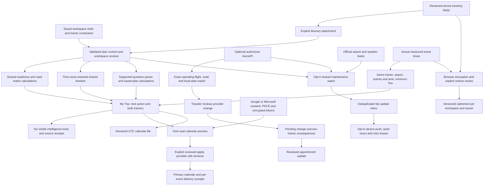

# Connected trip data flow

## Boundaries that matter

- The trip timeline comes from **saved records**; provider estimates do not silently overwrite it. Pending changes are labeled and calendar delivery is blocked until their review is resolved.
- My Trip exposes a saved-flight selector above the toolkit. All six tools receive that exact route, date and operating-flight context through the existing workspace-bound research handoff. The tools label these as saved planning fields; they do not imply a verified reservation.
- Readiness and assistant answers reuse the same normalized flight dates, source evidence and road calculations. A stated delay is an arithmetic margin comparison with fixed other inputs, not schedule propagation or an airline prediction.
- Shared-car and equipment access remain reported arrangements. The app exposes unresolved handoffs; it does not infer physical custody or a route between unspecified locations.
- Saved flight fields, public airport/weather conditions, historical cohorts, provider flight snapshots and personal measured records retain separate meanings. No absence of records is converted into zero delays or normal operations.
- Paid flight-provider requests require both the configured account key and an explicit deployment-owned workspace allowlist; arbitrary guest workspaces cannot use that account. Background polling also requires a host policy and trip opt-in.
- Provider matches use the operating identifier, airport pair and scheduled local departure date. Ambiguous matches, unavailable endpoints and missing source issue times remain explicit. Confirmation codes and raw confirmations are not queried or synchronized.
- Calendar writes use single-use, expiring previews; only the selected trainer’s resolved events are included. The provider edit version prevents overwriting an event changed after preview. Delivery is per event, with partial results and no automatic deletion, invitations or airline changes.
- Private transfer is an encrypted **review-and-restore** workflow with compare-and-set versions. It is not an automatic merge, an identity system or a substitute for an encrypted local device. Workspace capability links and trainer seats retain the app’s existing access model.
- Push contains only a generic prompt and non-secret trip/workspace identifiers. It never contains the workspace capability. Each trainer has a separate read receipt; queued delivery uses leases, deduplication, expiry and quiet hours. A host run and device permission are required; acceptance by a push service does not establish reading.
- My Trip hides timing results when the shared revision changes or the calculation becomes more than 15 minutes old. Provider checks and calendar previews enforce their own shorter expiry and version checks on the server.

See [setup and live validation](../operations/CONNECTED_TRIP_SETUP.md). Automated fixtures establish adapter behavior, not an authorized provider account’s coverage or a deployed scheduler’s delivery.
