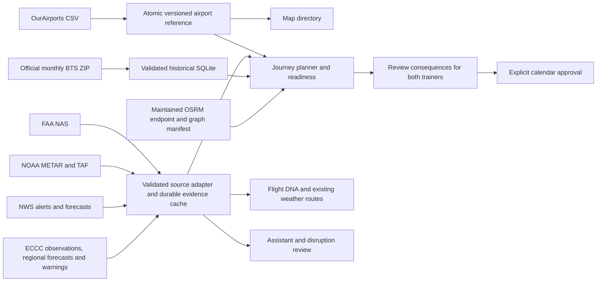

# Backend reliability and deployment setup

The active API is `artifacts/api-server/src/field-atlas/backend`. The standalone
backend export under `artifacts/field-sales-atlas/backend` is not the Replit runtime.
This change does not publish a deployment or supply external service credentials.

## Data flow and evidence



Every current weather conclusion requires a matching station/location, a usable
source timestamp within the adapter's freshness window, and applicable published
validity bounds where available. Cached retrieval time never replaces source time.
An outage can show a prior validated snapshot with a stale state; it cannot renew
that snapshot's observation time. An undated empty alert collection is partial,
not an all-clear. FAA airport omission is unknown, not a cleared flight.

The legacy aviation, NWS alerts and point-forecast endpoints now use the same
adapters as journey analysis. Forecast text is preserved up to 32 KiB per report;
oversized reports fail validation rather than silently losing forecast groups.
Canadian city-page periods do not supply exact validity timestamps: the app keeps
that gap explicit. Regional observations/warnings do not confirm airport or
individual-flight conditions.

The map directory and planner now read one OurAirports reference. An old map-only
snapshot is migrated with its original timestamp and remains stale until an
official refresh succeeds. Reference rows carry a dataset checksum; incomplete
refreshes never replace the last complete version. Map display is a US/Canada
view of that reference, including major/secondary and scheduled regional airports.
A reference listing does not prove scheduled airline service or seat availability.

BTS imports are historical U.S. reporting-carrier data, with publication lag and
coverage limits. Sync skips installed months only when the dataset row count
matches stored flight records. Successful alternate filenames clear the current
error while preserving failed attempts separately. A process lock prevents two
sync scripts from racing; status files are atomically replaced. The independent
Flyerintel historical source remains separately attributed and is not represented
as a direct BTS import.

## Verify the served code

- `/build-info.json`: the web build's JSON revision, build time and modified-source flag.
  Vite development mode labels its identity as development source, with no build time.
  Preview returns JSON 503 if metadata is missing instead of serving index HTML.
- `/api/build-info`: the API build's embedded identity. It does not infer identity
  from whatever commit happens to be checked out after the process was built.
- `/api/openapi.json`: live route/access inventory generated from registered routes,
  including workspace protection. This is a generic route contract; full business
  request/response schemas are still enforced in the server and are not claimed
  to be completely documented by this inventory. The health-client specification
  in `lib/api-spec` remains intentionally small.
- Travel → data connections: actual provider checks, source ages and limits,
  reference freshness, historical coverage, routing probe and maintenance status.
  Research catalog entries are explicitly design-only, not connected providers.

Run in the repository root:

```sh
pnpm run data:check-sources
pnpm run data:airports
pnpm run data:sync-bts
pnpm run data:maintain
```

`data:maintain` catches up missed work and records success/failure; it exits nonzero
when a job fails. It does not edit calendar appointments. Source checks sample
MCO and YYZ weather, each of the four Flyerintel datasets, a bounded MCO
checkpoint-history query, Census ZCTAs, installed BTS history and an actual Orlando road-routing probe.
They do not validate every airport in North America. Validation requests can choose
one to four airport codes; the default road probe is Orlando airport to downtown.

## Scheduled refresh and sleeping deployments

Daily maintenance is due at 06:00 America/New_York, including DST. Before that
hour, an awake instance catches up yesterday's pass. Persisted completion keys,
compare-and-swap leases and retry delays prevent duplicate daily passes across
restarts/processes sharing the same SQLite file. The API checks each minute and
travel watches retain their existing 30-second awake review loop. A configured
BTS job can run up to 25 minutes under a 30-minute lease.

In-process timers cannot wake a sleeping autoscale deployment. The optional
`.github/workflows/maintenance.yml` calls a configured host every 15 minutes. It
skips until the repository variable `ATLAS_MAINTENANCE_ENABLED=true` and secrets are supplied; GitHub schedules can be delayed or
disabled, so this is not a guaranteed real-time flight monitor.

Configure on the deployed host, using its Secrets interface:

- `ATLAS_MAINTENANCE_TOKEN`: a random secret of at least 32 characters. Do not put
  it in a URL or commit it. Only a matching bearer token may invoke the endpoint.
- `ATLAS_BTS_AUTO_SYNC=1`: opt into recent monthly BTS downloads during daily
  maintenance. This is disabled by default because imports can be large.
- `ATLAS_BACKUP_DIR`: an absolute directory outside the application data directory
  on separately managed durable storage, if automatic backups are desired.

Configure matching **GitHub repository secrets**:

- `ATLAS_MAINTENANCE_URL`: `https://YOUR-HOST/api/maintenance/run`
- `ATLAS_MAINTENANCE_TOKEN`: the same host secret.

Set the GitHub repository **variable** `ATLAS_MAINTENANCE_ENABLED` to `true`
only after configuring those secrets. This keeps the scheduled job disabled
without starting runners while the connection is unconfigured.

Use workflow dispatch once, inspect its outcome and the data-connections job
history, then verify another scheduled delivery. Token presence proves only that
a trigger is configured; diagnostics deliberately do not claim scheduler delivery.
The endpoint never accepts a workspace key as maintenance authorization. Failed
jobs retain the last successful data and retry after 15 minutes.

## Durable records and recovery

Local SQLite WAL is supported for a **single application instance on a persistent
volume**. Independent autoscale filesystems are not a shared database and SSE
connections are process-local. This repository cannot prove or provision the
host's persistent volume. Configure a single persistent deployment, or migrate
the database and event transport to shared services before enabling multiple
instances. A successful local read/write test is not proof of deployment durability.

Create and verify backups from the repository root:

```sh
pnpm run data:backup /absolute/separate-storage/atlas-backups
pnpm run data:verify-backup /absolute/separate-storage/atlas-backups/atlas-TIMESTAMP
```

The backup uses SQLite's online backup API, including committed WAL records.
Each database snapshot gets an integrity check, a streaming SHA-256 checksum and
an atomic completion manifest. Files use owner-only permissions. The restore
verifier copies files into a fresh temporary directory, checks checksums, runs
SQLite integrity checks and validates the application records table. It never
overwrites the running database. Each SQLite file is consistent independently;
the manifest does not claim a cross-database transaction.

Backups contain private workspace records and capability records: protect them
as secrets. Keep an encrypted off-host copy and test retrieval on the real host.
This tool covers `atlas.sqlite` and installed `bts.sqlite`, not routing graphs,
environment secrets or other host configuration. Rebuild routing graphs from
validated sources; retain deployment configuration in the host's secure system.
For an actual restore, stop writers, preserve the current data directory, verify
the backup, and restore into a **new** data directory before switching the host's
`ATLAS_DATA_DIR`. Validate workspace access and records there before resuming.
The app never automatically overwrites a database to restore a backup.

## Road routing: activation still requires a host

For an environment with a persistent Docker daemon and sufficient resources:

```sh
pnpm run setup:routing --region florida
# Or the larger FL/GA/NC/SC extract:
pnpm run setup:routing --region southeast
```

Setup validates Geofabrik checksums, builds the regional OSRM graph, records its
coverage/version and activates only after a real table probe. This can be large;
it is not run automatically on application startup. On a separate maintained
routing host, expose OSRM through HTTPS and configure `ATLAS_ROUTING_URL` on the
app host. A remote endpoint alone leaves graph age/coverage unverified; retain a
matching validated manifest when you manage that graph. Do not use a public demo
endpoint as a production dependency. Never put credentials into the endpoint URL.

Run `data:check-sources` and verify `routingProbe.roadBased=true` with a non-null
route before relying on road estimates. Test unreachable and out-of-region
locations as well. Routing still excludes live traffic, border queues and road
closures. Without a verified service the app retains explicit geographic estimates
and cannot establish drivable-route feasibility. No external road service was
activated on Replit by this change.

## Flight status and confirmation numbers

No flight-specific or booking provider is configured. A confirmation number alone
does not authorize an airline reservation lookup. Keep booking fields and changes
traveler-supplied until a suitable provider is selected and authorized. Weather,
FAA airport notices, historical outcomes and ADS-B positions do not verify a PNR,
flight availability or a cancellation. Airline availability still needs independent
verification before approving recovery options. No airline status access, model
credentials or deployment secrets are fabricated by this implementation.
